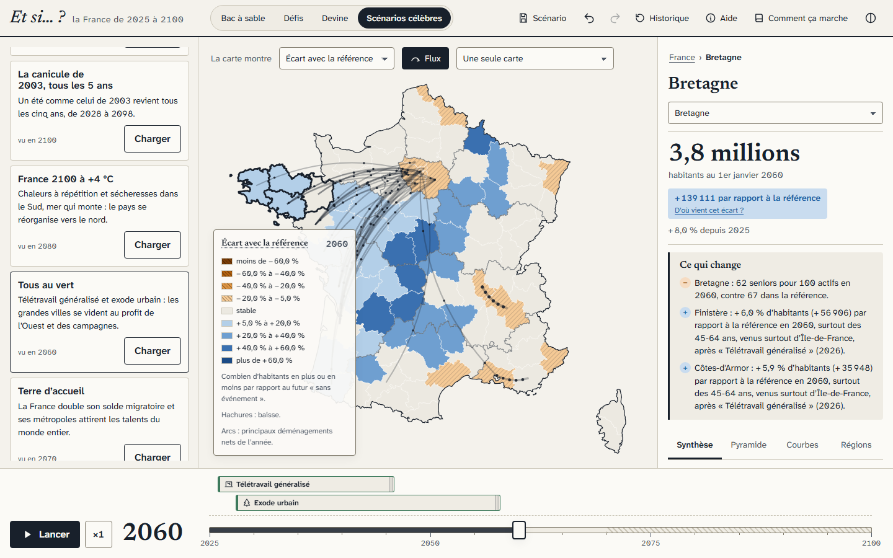

# Et si… ?

**Un jeu de simulation démographique de la France dans le navigateur.** On déclenche des événements (pandémie, canicules, politique nataliste, télétravail, exode urbain…) et on observe, année après année et département par département, comment la population s'écarte d'un futur de référence fondé sur les données de l'Insee.



## Installation

Il faut Node 22 ou plus. Python 3.11 ou plus n'est nécessaire que pour reconstruire les données.

```bash
npm install
npm run dev        # http://localhost:5173
```

Les données compactes sont livrées dans `public/data/` : rien à télécharger pour jouer.

## Commandes

| Commande | Rôle |
|---|---|
| `npm run dev` | Serveur de développement |
| `npm run build` puis `npm run preview` | Version de production |
| `npm test` | Tests du moteur (Vitest) : conservation, agrégations, déterminisme, performance, écarts aux projections Insee, événements, cascades, défis, partage |
| `npm run e2e` | Parcours Playwright, sur ordinateur et téléphone : tutoriel, ajout d'événement, glisser-déposer, défi réussi, Devine, lien partagé, exports, accessibilité (axe) en clair et en sombre |
| `npm run lint` / `npm run typecheck` | Qualité du code (TypeScript strict) |
| `npm run data` | Retélécharge les sources Insee (≈ 200 Mo) et reconstruit `public/data/` |

Pour `npm run data`, créez une fois l'environnement Python :

```bash
python -m venv .venv-data
.venv-data/Scripts/python -m pip install -r scripts/build-data/requirements.txt   # Windows ; bin/python ailleurs
```

## Ce qu'on peut faire

- **Carte de France** des 101 départements, outre-mer et Paris avec sa petite couronne en médaillons, avec 6 couches à échelle fixe (écart à la référence, évolution, âge médian, seniors pour 100 actifs, arrivées moins départs, densité) et les déménagements animés.
- **Frise 2025-2100** : lecture, pause, vitesse ; les événements y sont des blocs qu'on déplace et qu'on allonge.
- **33 événements** (30 dans la bibliothèque, 3 déclenchés seulement par des cascades) et un éditeur pour créer les siens, avec des **cascades** visibles (canicules → crise agricole → migration vers le nord → logement). Chacun affiche son **niveau de preuve** : 7 reproduisent des variantes officielles de l'Insee (intensité et zone verrouillées), 2 sont calés sur l'histoire (2020, 2003), les 24 autres sont des hypothèses de jeu.
- **Analyse** :
  - récit automatique ;
  - « D'où vient cet écart ? » : naissances, décès, migrations et part de chaque événement ;
  - pyramide des âges animée ;
  - courbes ;
  - 13 régions côte à côte ;
  - comparaison avant / après sur la carte.
- **Modes de jeu** :
  - bac à sable ;
  - 9 défis notés, avec des garde-fous (aucun ne se gagne avec une seule carte) et un résultat révélé quand on lance le temps ;
  - « Devine » : 8 questions dont les réponses sont calculées par le moteur, avec un récapitulatif à partager ;
  - 5 scénarios célèbres ;
  - tutoriel interactif de 4 étapes.
- **Sauvegarde et partage** :
  - scénarios enregistrés sur l'appareil, et le bac à sable en cours repris après une recharge ;
  - lien qui contient tout le scénario et l'année affichée ;
  - export PNG de la carte et CSV des données ;
  - export et import JSON ;
  - annuler et rétablir sans limite.
- **Accessibilité** :
  - tout se fait au clavier ;
  - ARIA ;
  - jamais la couleur seule (signes, hachures) ;
  - palettes adaptées aux daltoniens ;
  - thèmes clair et sombre ;
  - `prefers-reduced-motion` respecté ;
  - mise en page adaptée au téléphone.

## Le modèle en termes simples

Chaque année, pour chaque département, chaque sexe et chaque âge :

1. tout le monde vieillit d'un an, et une petite partie décède, selon les risques de décès de l'Insee ;
2. des bébés naissent, selon le nombre d'enfants que les femmes ont à chaque âge ;
3. des habitants déménagent vers d'autres départements, comme on l'observe au recensement ;
4. des personnes arrivent de l'étranger ou partent.

C'est la **méthode des composantes**, celle des démographes. Sans événement, le moteur suit les projections 2026 de l'Insee, et les écarts sont mesurés et testés. Les événements « Variante Insee » reproduisent les variantes officielles des projections (écart vérifié par des tests) ; les autres effets sont signalés comme calés sur l'histoire ou comme hypothèses de jeu. Tout est détaillé dans la page « Comment ça marche » de l'application, dans [DECISIONS.md](DECISIONS.md) (hypothèses, choix, limites) et dans [DATA_SOURCES.md](DATA_SOURCES.md) (sources et dates).

## Structure

```
scripts/build-data/   construction des données (Python + DuckDB)
public/data/          données compactes (JSON versionnés)
src/engine/           moteur pur : simulate(), indicateurs, décomposition, validation
src/worker/           Web Worker de simulation (Comlink)
src/events/           bibliothèque d'événements, zones, icônes
src/game/             défis, Devine, scénarios célèbres
src/story/            récit automatique
src/state/            état (Zustand + historique), sauvegarde, partage, exports
src/ui/               interface (React)
tests/engine/         tests Vitest       e2e/   parcours Playwright
design-system/        design system (MASTER.md)
```

## Licence des données

Insee et IGN, Licence Ouverte / Etalab 2.0.
